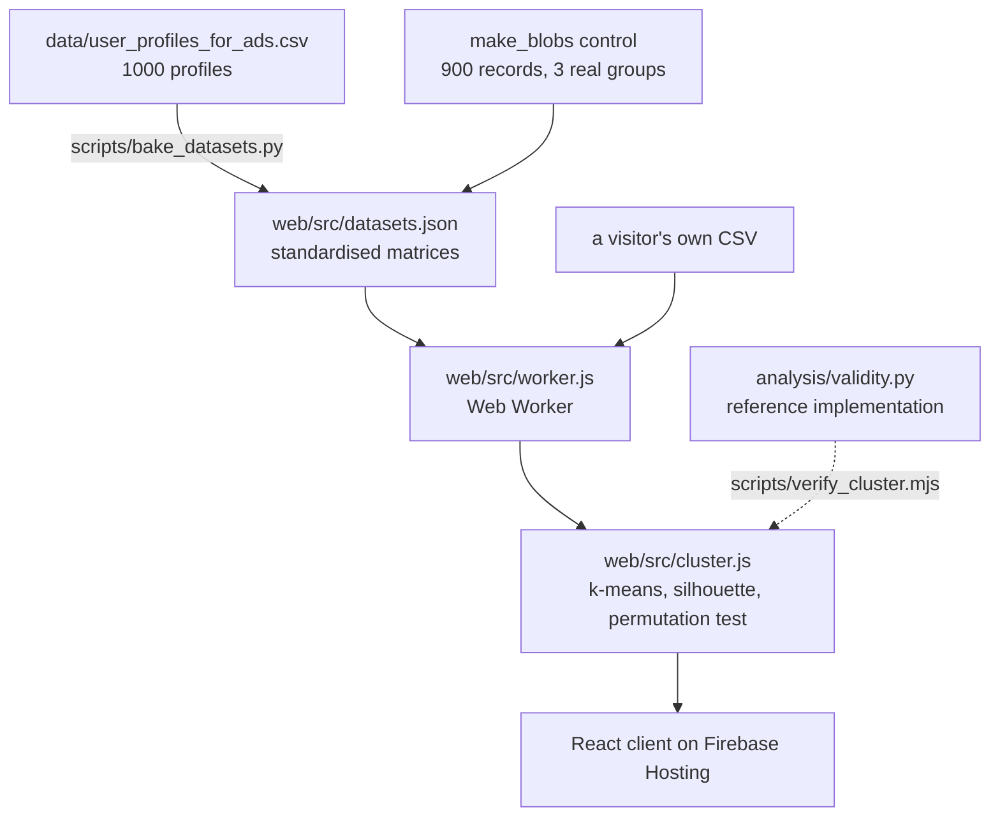

# Architecture

## Shape of the system

No server. The dashed edge is what makes that safe.

## The method

**k-means** with k-means++ seeding, written out rather than imported, because
the browser has to run the identical algorithm.

**Silhouette** on a subsample of 400 points. It is quadratic in the number of
points and a few hundred estimate the mean closely enough for a yes or no.

**The null** shuffles each column independently. Every marginal distribution
is preserved exactly and only the joint structure is destroyed, which is the
thing clustering claims to find. A null that resampled from a Gaussian would
test something weaker: whether the data is Gaussian, not whether its columns
relate to each other.

**The verdict** is a max-statistic permutation test. Scoring seven values of k
and reporting the best is seven chances to clear a threshold. Each shuffled
copy is therefore scored at every k and only its best kept, so the null is the
distribution of the best silhouette obtainable by searching over k, and the
comparison needs no multiplicity correction afterwards.

This matters practically: a Bonferroni correction would demand p <= 0.05/7 =
0.007, and with 30 shuffles the smallest attainable p is 1/31 = 0.032. No
dataset could ever have passed.

## Decisions

**An empirical p, not a z-score.** The null's standard deviation is itself
estimated from a few dozen draws, and dividing by it turns ordinary noise into
impressive-looking sigmas. An early version of this page reported 2.2 standard
deviations for data whose permutation p was 0.19. Counting how often the null
beat the real data assumes nothing about the null's shape.

**30 shuffles.** The floor on p is 1/(R+1), so R sets the strongest claim
available: 30 gives 0.032, just inside a conventional threshold. More would be
better and slower; this runs in about six seconds.

**A control dataset ships with the page.** A test that only ever answers "no"
is indistinguishable from a broken test. `make_blobs` with three centres and
heavy overlap is run through the identical code in front of the reader.

**Standardisation, always.** Distances are meaningless across columns with
different units, and k-means is a distance method.

**A worker.** 30 shuffles at 7 values of k is 217 clusterings and 217
silhouettes. On the main thread the page would freeze.

## The other three tests

**Gap statistic** (Tibshirani, Walther and Hastie, 2001) compares log
within-cluster dispersion against the same quantity on data drawn uniformly
from the bounding box. The reference has no clusters by construction but keeps
the data's extent, so this asks whether the clusters are tighter than spread
alone would give. The selection rule takes the smallest k whose gap is within
one standard error of the next k's, rather than the maximum, which
over-selects.

**Bootstrap stability** resamples with replacement, clusters the resample, and
measures agreement with the original labelling on shared points via the
adjusted Rand index. Real groups survive having members removed and
duplicated; a partition of noise is redrawn somewhere else each time. It
assumes nothing about a null distribution, which is what makes it independent
evidence rather than a second permutation test.

**Three algorithms** because k-means assumes round, equal-sized groups. A
Gaussian mixture with diagonal covariances allows different widths per axis, so
it can hold elongated groups that k-means splits. Ward linkage builds groups by
merging rather than by distance to a centre, so it can find structure k-means
cannot. If only one of them finds something, that something is probably its
assumption, and the page says so.

The Gaussian mixture uses diagonal rather than full covariances. A full
covariance needs a matrix inverse per component per iteration, which is a lot
of linear algebra to reimplement identically in two languages for a question
that does not turn on it. The assumption is stated rather than hidden.

## What this does not do

It does not say which clustering algorithm to use, and it does not rescue a
dataset that has no structure. It answers one question: whether the groups a
clustering returned are more than a partition of noise.

Running three algorithms addresses, but does not eliminate, the dependence on
any one of their assumptions. All three are still centroid or variance based,
so a dataset with genuinely non-convex structure, rings or spirals, could fail
every test here and still contain groups. The honest statement remains "these
methods found nothing beyond chance", not "this data has no structure".

The heavy tests run on a 500 point subsample when the data is larger, since
silhouette and Ward linkage are both quadratic. That is ample for a yes or no
and keeps the whole run under ten seconds. The permutation test is linear in
the rows but clusters them 217 times, so above 2,000 rows it runs on a seeded
sample of 2,000 (the 500 are drawn from within it), and the page says so
before the verdict arrives. Both built-in datasets are under 2,000 rows and
are tested whole.

## Verification

`scripts/verify_cluster.mjs` requires the browser implementation to reproduce
`analysis/validity.py` exactly, not approximately. Both draw from one
mulberry32 generator reimplemented identically in each language, so the random
sequences match and the results can be compared as numbers rather than as
distributions. 38 values compared; worst relative difference 5e-16.
